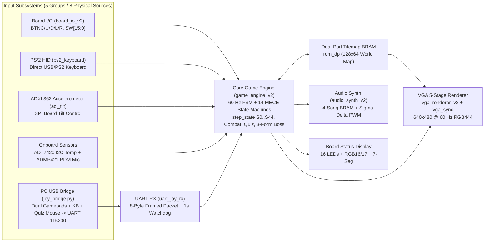
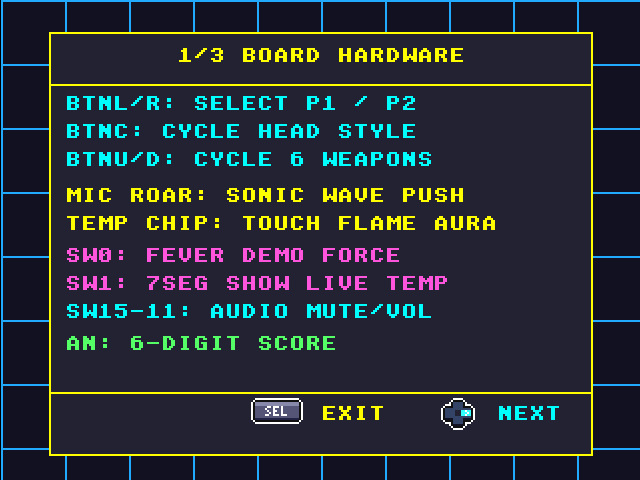
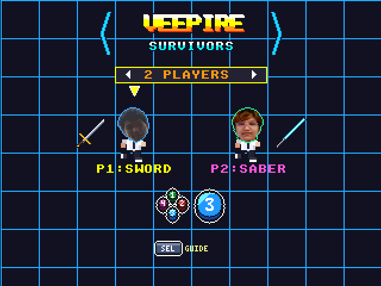
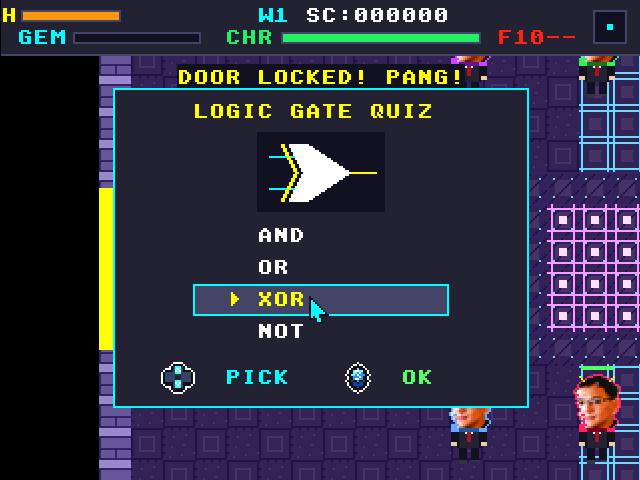
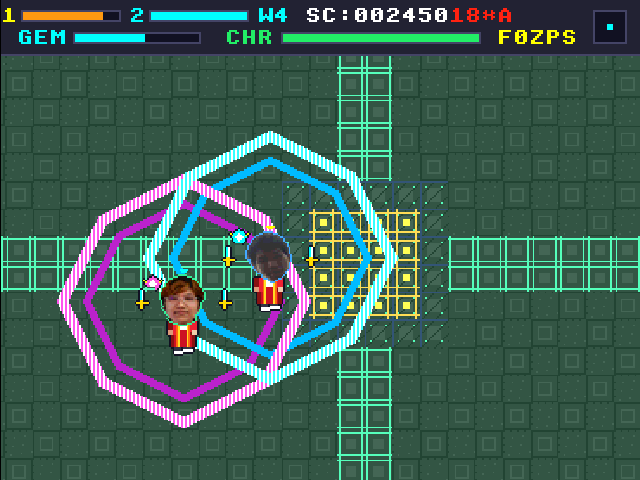

# VeePire Survivors (DRAGO-NEXUS V2)

Pure Verilog HDL 2D action-survival game engineered for the **Digilent Nexys A7-100T** (`XC7A100T-1CSG324C`) FPGA without a soft-core CPU or OS overhead. Runs natively at **640x480 @ 60 Hz VGA** with a 5-stage, 20-layer priority sprite compositor, Sigma-Delta PWM chiptune audio, dual USB/PS2/UART controls, interactive Logic Gate Quizzes, and live onboard sensor integration.


-1e3a8a?style=flat-square)
-15803d?style=flat-square)


**Live Hardware & Gameplay Demonstration:** [https://youtu.be/QB_I7KzzW_8](https://youtu.be/QB_I7KzzW_8)

---

## Table of Contents

1. [Overview & System Architecture](#overview--system-architecture)
2. [Visual Showcase](#visual-showcase)
3. [Implemented Gameplay & Hardware Features](#implemented-gameplay--hardware-features)
4. [Controls & Hardware Inputs](#controls--hardware-inputs)
5. [Implementation Metrics (Vivado 2024.2)](#implementation-metrics-vivado-20242)
6. [Repository Structure](#repository-structure)
7. [Build, Simulation & Usage](#build-simulation--usage)
8. [Team & License](#team--license)

---

## Overview & System Architecture

All game logic, physics, AI, quiz state machines, BRAM graphics rendering, audio synthesis, and sensor decoders execute concurrently at a **25 MHz** system/pixel clock (`clk25` derived from `CLK100MHZ` via MMCM in `rtl/clk_gen.v`). To achieve comfortable timing closure with `0` inferred latches, `rtl/game_engine_v2.v` uses a time-multiplexed 60 Hz update loop (`step_state S0..S44`) paired with a 5-stage pipelined VGA renderer (`rtl/vga_renderer_v2.v`).



---

## Visual Showcase

| Auto Control Detection (Gamepad to Keyboard) | 2-Player Title & Mode Selection |
| :---: | :---: |
|  |  |
| **Mouse-Interactive Logic Gate Quiz** | **Wave 6 Boss & Fever Shockwave** |
|  |  |

---

## Implemented Gameplay & Hardware Features

### 1. Player Movement, Combat & 2P Co-op
- **Character & Weapon Selection:** Cycle 4 heroes (`PF`, `PPuen`, `PPeem`, `PPing`) via `BTNC` and 6 weapons (`Greatsword`, `Lightsaber`, `Boxing Fists`, `Battleaxe`, `Spear`, `Scythe`) via `BTNU`/`BTND` (`BTNL`/`BTNR` toggle active P1/P2 selection).
- **World & Camera:** 8-directional player movement across a `2048x1024` pixel arena (`128x64` Dual-Port Tilemap BRAM in `rtl/drago_nexus_v2_top.v` / `rtl/roms.v`) with real-time wall collision and smooth camera tracking.
- **Combat Mechanics:** 3-hit melee lunge combo, dash with afterimages, 360-degree Nova Finisher, and ranged energy projectiles.
- **2-Player Co-op:** Simultaneous local P1/P2 play with independent 24-unit HP bars and teammate revival on portal transitions.

### 2. Wave Progression, Logic Gate Quiz & 3-Form Boss
- **6 Escalating Waves (`Wave 1` to `Wave 6`):** Clearing waves activates a golden navigation arrow toward the east Logic Gate Quiz portal.
- **Logic Gate Quiz & Retake Penalty:** Randomizes 1 of 6 digital logic gates (`AND`, `OR`, `NOT`, `NAND`, `NOR`, `XOR`) with truth tables. Answer via Quiz Mouse hover/click, Keyboard (`1`–`4`), or Gamepad. Incorrect answers trigger `WRONG! GO RETAKE!` and replay the wave.
- **4 Evolution Stages:** Passing quizzes unlocks cutscenes advancing through `Student` -> `CPE Shop` (+ combat pet) -> `Red Gown` (+ orbiting blades) -> `Gold Armor` (+ power aura, speed, and range boosts).
- **Wave 6 Multi-Phase Boss:** Consecutive 3-form boss battle featuring `Form 0` (Goose), `Form 1` (Armored horizontal laser sweeps), and `Form 2` (Enraged mode below half HP).

### 3. Control Auto-Detection & Onboard Sensor Integration
- **Auto Control Detection & 4-Page Guide:** Dynamically updates on-screen prompt badges between `1P/2P Dual Gamepad` and `1P Keyboard` depending on active input. Press `ESC` (or `Select`) to browse the 4-page Control Guide (`1/4` Board, `2/4` Joystick, `3/4` Keyboard, `4/4` Quiz Mouse).
- **ADT7420 Temperature Sensor (I2C — `rtl/i2c_temp_adt7420.v`):** View live temperature on the 7-Segment display using `SW[1]`; exceeding baseline `+1°C` / `35°C` (or toggling `SW[0]`) activates **Thermal Fever Mode** (`temp_fever`) for boosted attack power.
- **ADMP421 MEMS Microphone (PDM — `rtl/pdm_mic_decoder.v`):** Sound peaks above threshold trigger an octagonal sonic shockwave (`mic_roar`) pushing nearby enemies away.
- **ADXL362 Accelerometer (SPI — `rtl/acl_tilt.v`):** Tilt-based Player 1 movement with pushbutton zero-point calibration.
- **Audio & Board Feedback (`rtl/audio_synth_v2.v`, `rtl/board_io_v2.v`):** 4 BRAM chiptune songs + priority SFX output via `AUD_PWM`/`AUD_SD`, volume/mute via `SW[15:11]`, 16-LED bar meters, dual RGB LEDs (`LED16`/`LED17`), and multiplexed 8-digit 7-Segment score/temp display.

---

## Controls & Hardware Inputs

### Onboard Nexys A7-100T Controls

| Hardware Signal | Function |
| :--- | :--- |
| `BTNL` / `BTNR` | Switch active player slot (`P1` / `P2`) on Title / Select |
| `BTNC` | Cycle Hero (`PF`, `PPuen`, `PPeem`, `PPing`) |
| `BTNU` / `BTND` | Cycle Weapon (6 weapons) |
| `SW[0]` | Force Thermal Fever override |
| `SW[1]` | Display live ADT7420 temperature on 7-Segment display |
| `SW[15:11]` | Audio volume control / mute switches |
| `ADXL362` (SPI) | Board-tilt movement control |
| `ADT7420` (I2C) | Live temperature sensing -> Thermal Fever boost |
| `ADMP421` (PDM) | Voice roar -> Octagonal sonic shockwave |
| `PS2_CLK` / `PS2_DATA` | Direct USB/PS2 keyboard host (OR-merged with PC UART KB) |
| `CPU_RESETN` | Active-low master hardware reset |

### PC Peripherals via `scripts/joy_bridge.py` (UART 115200 Baud, 8-Byte Packet)

| Device | Mapping |
| :--- | :--- |
| **Dual USB Gamepad (`1P` / `2P`)** | D-Pad / Left Stick: Move, `Btn 3` (Blue): Attack/Start, `Btn 2` (Red): Dash, `Btn 1` (Green): Shoot, `Btn 4` (Pink): 360 Nova, `Start`: Pause, `Select`: Control Guide / Menu |
| **PC Keyboard (`1P`)** | `WASD` / Arrows: Move, `Space` / `J`: Attack/Start, `K` / `E` / `Z`: Dash, `3` / `L`: Nova, `4` / `U`: Shoot, `1`–`4`: Quiz Answer, `Enter`: Pause, `Esc`: Control Guide |
| **PC Mouse (`RP_QUIZ` Only)** | Hidden during combat; Move cursor to hover options `A`–`D` and `Left Click` to answer Logic Gate Quiz |

---

## Implementation Metrics (Vivado 2024.2)

Verified from [`timing_summary.rpt`](timing_summary.rpt) and [`util_summary.rpt`](util_summary.rpt) targeting `xc7a100tcsg324-1`:

| Metric | Value | Notes |
| :--- | :--- | :--- |
| **Target Clock** | `25.00 MHz` (`clk25`) | Derived from `CLK100MHZ` via MMCM |
| **Worst Negative Slack (WNS)** | `+10.398 ns` | `0` failing endpoints out of `12,623` |
| **Worst Hold Slack (WHS)** | `+0.055 ns` | `0` failing endpoints out of `12,623` |
| **Slice LUTs** | `28,920 / 63,400` (`45.62%`) | Logic: `28,917`, LUTRAM: `3` |
| **Slice Registers (Flip-Flops)** | `5,650 / 126,800` (`4.46%`) | **`0` inferred Latches** |
| **Block RAM Tile** | `56.5 / 135` (`41.85%`) | `55` RAMB36E1 + `3` RAMB18E1 |
| **DSPs (`DSP48E1`)** | `12 / 240` (`5.00%`) | Coordinate & scaling datapath |

---

## Repository Structure

```text
.
├── .github/
│   ├── assets/                     # Lightweight screenshots/GIF for README
│   ├── workflows/ci.yml            # GitHub Actions: iverilog lint, py_compile, .mem check
│   ├── ISSUE_TEMPLATE/             # Structured bug report template
│   └── PULL_REQUEST_TEMPLATE.md
├── constrs/
│   └── nexys_a7_game_v2.xdc        # Nexys A7-100T master constraints
├── mem/                            # 16 BRAM/ROM .mem initialization files
├── rtl/
│   ├── drago_nexus_v2_top.v        # Top-level module & clock/reset/peripheral integration
│   ├── game_engine_v2.v            # 60 Hz time-multiplexed FSM core, combat, quiz, bosses
│   ├── vga_renderer_v2.v           # 5-stage, 20-layer VGA sprite & HUD compositor
│   ├── vga_sync.v                  # 640x480 @ 60 Hz VGA timing & game_tick generator
│   ├── clk_gen.v                   # 100 MHz -> 25 MHz MMCM clock generator
│   ├── roms.v                      # Dual-port, single-port, and LUT ROM primitives
│   ├── uart_joy_rx.v               # 8-byte UART packet decoder (115200 baud + 1s watchdog)
│   ├── ps2_keyboard.v              # PS/2 HID scancode decoder (make/break)
│   ├── acl_tilt.v                  # ADXL362 SPI accelerometer driver & zeroing
│   ├── i2c_temp_adt7420.v          # ADT7420 I2C temperature sensor & Fever trigger
│   ├── pdm_mic_decoder.v           # ADMP421 PDM microphone loudness/roar detector
│   ├── audio_synth_v2.v            # BRAM 4-song chiptune + priority SFX PWM audio
│   ├── board_io_v2.v               # 5 ms debouncer, LED/RGB/7-Segment controllers
│   ├── joy_palette.vh              # Auto-generated 16-color gamepad HUD palette
│   └── kb_palette.vh               # Auto-generated 16-color keyboard guide palette
├── scripts/
│   ├── build_bitstream.tcl         # Portable Vivado batch synth/impl/bitstream/reports script
│   ├── program_fpga.tcl            # Portable Vivado JTAG FPGA programmer
│   ├── check_hw.tcl                # Vivado hardware server diagnostic
│   ├── joy_bridge.py               # Windows Dual Gamepad + KB + Quiz Mouse -> UART bridge
│   ├── generate_assets_v2.py       # BRAM map, font, BGM, and sprite .mem generator
│   ├── generate_ui_assets.py       # UI button/gamepad icon ROM generator
│   └── generate_v4_assets.py       # 4-frame hero walk & keyboard guide ROM generator
├── sim/
│   ├── run_sim.ps1                 # Portable Vivado xsim runner (stages mem/*.mem to sim_work/)
│   ├── tb_game_v2.v                # Core engine functional testbench
│   ├── tb_v6_verify.v              # Audio/board_io/fever/sonic verification
│   ├── tb_v7_ui_audit.v            # UI alignment & control guide audit
│   ├── tb_verify_ui_kbd.v          # Keyboard switching & guide page verification
│   ├── tb_v8_mouse_quiz.v          # Quiz-only mouse cursor/click & Page 4/4 verification
│   └── tb_vga_capture.v            # Frame capture testbench
├── .gitattributes
├── .gitignore
├── LICENSE
├── README.md
├── requirements.txt
├── start_joystick.bat
├── timing_summary.rpt
└── util_summary.rpt
```

---

## Build, Simulation & Usage

### Prerequisites
- **AMD Xilinx Vivado** (tested with `2024.2`) targeting `xc7a100tcsg324-1`
- **Python 3.9+** on Windows for `scripts/joy_bridge.py` (uses Windows built-in `winmm.dll` / `user32.dll` / `kernel32.dll` via `ctypes`; no external packages required)
- `Pillow` (`pip install -r requirements.txt`) only if regenerating `.mem` assets via `scripts/generate_*.py`

### 1. Run RTL Simulation (`xsim`)
Stages `mem/*.mem` into `sim_work/` automatically so all `$readmemh` ROM paths resolve cleanly:
```powershell
powershell -ExecutionPolicy Bypass -File sim/run_sim.ps1 -Testbench tb_v8_mouse_quiz
```

### 2. Synthesize & Build Bitstream (Vivado Batch)
Generates `build/drago_nexus_v2_top.bit` and updates `timing_summary.rpt` / `util_summary.rpt`:
```bash
vivado -mode batch -source scripts/build_bitstream.tcl
```

### 3. Program Nexys A7-100T FPGA
```bash
vivado -mode batch -source scripts/program_fpga.tcl
```

### 4. Launch PC Controller / Keyboard / Quiz Mouse Bridge
Double-click `start_joystick.bat` or run directly:
```bash
python scripts/joy_bridge.py
```

---

## Team & License

Developed by **Team G06** for **CPE222 Digital Electronics and Logic Design**, Department of Computer Engineering, Faculty of Engineering, King Mongkut's University of Technology Thonburi (KMUTT).

- **Advisor:** ดร.ทวีชัย นันทวิสุทธิวงศ์ (KMUTT)

| Student ID | Name | Primary Ownership |
| :--- | :--- | :--- |
| `68070501013` | ณัฐกิตติ์ พรมวิสิทธิ์ | `vga_sync`, `clk_gen`, `board_io_v2` |
| `68070501015` | ณัฐชนันท์ กิจประยูร | `game_engine_v2` |
| `68070501024` | นราวิชญ์ สันดอน | `vga_renderer_v2`, `roms`, sprite/BRAM asset pipeline |
| `68070501050` | ศศิเลขา เงินยางแดง | `joy_bridge.py`, `uart_joy_rx`, `ps2_keyboard`, audio & sensor drivers |
| `68070501051` | ศิวัต กุตตระ | Testbenches, Vivado timing/synthesis, demonstration & verification |

Licensed under the [MIT License](LICENSE).
