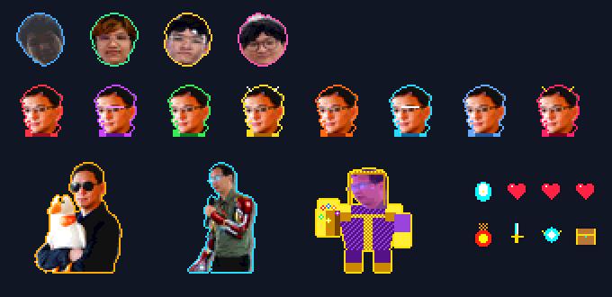
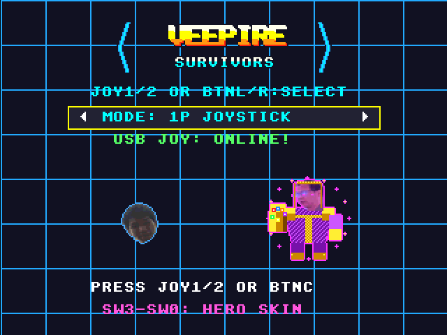
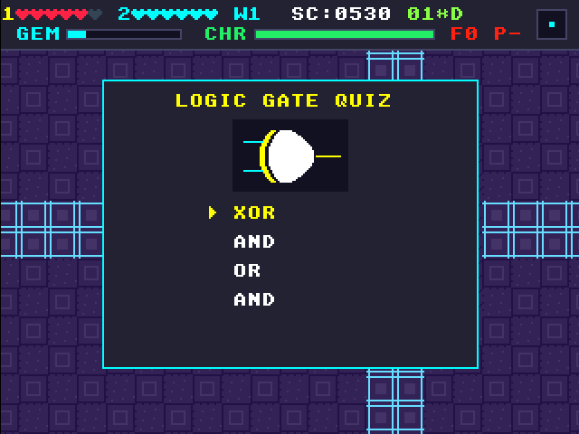
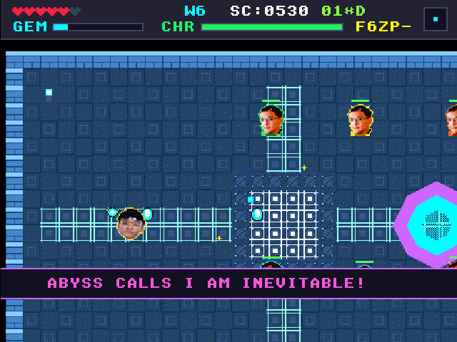
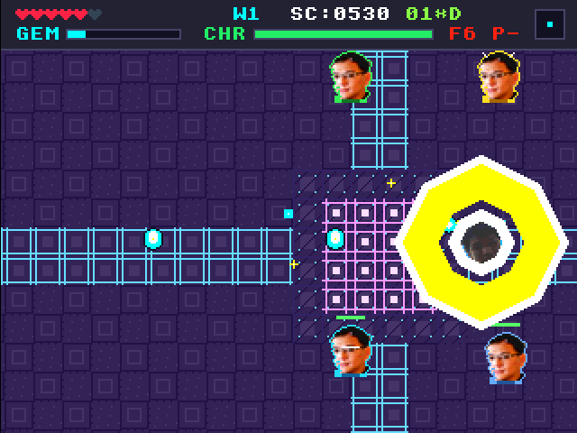

# VeePire Survivors (DRAGO-NEXUS V4 KMUTT Edition)
> **Pure Hardware FPGA 2D Action RPG Co-op Game (No Soft-Core / No CPU)**  
> Developed for **Digilent Nexys A7-100T (Artix-7 XC7A100T-1CSG324C)**  
> Running at **100% Native 60 FPS VGA (640×480 @ 60Hz)** with custom RTL Audio, Sprite Engine, Dual Gamepad Support, and Hardware Accelerometer.



---

## 🎮 Game Overview

**VeePire Survivors** is a high-octane 2D Action RPG Survival game implemented entirely in Verilog HDL. Facing endless swarms of rogue enemies and the formidable **Ajarn_V**, players fight through waves of increasing difficulty, upgrade their gear with KMUTT academic uniforms, solve logic gate checkpoints, and survive epic multi-phase boss encounters.

- **Platform:** Digilent Nexys A7-100T FPGA Board
- **Clock:** 100 MHz System Clock -> 25.175 MHz VGA Pixel Clock via MMCM
- **Resolution:** 640×480 @ 60 FPS (Sub-sampled internal coordinates with bilinear/nearest-neighbor scaling)
- **Architecture:** 100% Pure RTL Hardware Logic (Zero CPU, No MicroBlaze, Zero OS overhead)
- **Audio:** Custom 4-Voice Chiptune Audio Synthesizer + Sequencer ROM (BRAM) with Kick, Snare, Hi-hat, and PWM output

---

## 📸 In-Game Screenshots & Previews

| Title Screen & Metallic Logo | 2-Player Co-op & Dynamic Camera |
|:---:|:---:|
|  |  |
| **Ajarn_V Boss Battle & Auto-Lock Gun** | **Gate Checkpoint & Upgrade Cutscene** |
|  |  |

---

## ✨ Key Features & Architecture

### 1. 🎓 KMUTT Progression & Procedural Outfits
Heroes feature high-resolution real human face sprites with procedurally synthesized bodies, uniforms, and legs:
- **Wave 1 — KMUTT Student Uniform:** White long-sleeve dress shirt, dark tie, black slacks, and dress shoes.
- **Wave 2 — KMUTT CPE Workshop Shirt:** Department navy shop coat (`#405F73`), inner white V-neck collar, chest pocket, and dark pants.
- **Wave 3+ — KMUTT Graduation Gown:** Formal black academic gown with vibrant Orange & Gold satin sashes (`#FD2` / `#F61`).

### 2. ⚔️ 4-Phase Fluid Melee Sword Combo
- Dynamic 4-stage sword swing arc: **Stance ➔ Anticipation ➔ Shear ➔ Hit ➔ Follow-Through**.
- High-reach slashing range (~34px reach) with crisp silver/white trailing edge.
- **360° Nova Finisher:** Full circular double-ring shockwave that repels and clears surrounding mobs.

### 3. 🎯 100% Hardware Auto-Lock Gun
- Hardware lock-on reticle that automatically tracks the nearest alive enemy or boss.
- Single-target plasma bullet projectile with 100% trajectory lock, eliminating thumbstick aiming friction.

### 4. 🚪 Digital Logic Gates & Academic Retake Penalty
- Mid-wave transition checkpoints require players to answer digital logic gate questions (AND, OR, XOR, NAND, NOR, XNOR).
- **Correct Answer:** Triggers a transformation cutscene showcasing the new KMUTT uniform upgrade with celebratory fanfare.
- **Wrong Answer:** Triggers the **Giant 128×128 Angry Ajarn_V Form 2** caution banner, flashing `"GRADE F - GO RETAKE !!"`, dealing damage, and resetting the wave.

### 5. 👹 Multi-Phase Bosses & Swarm Enemies
- **Black Suit Grunt Enemies:** Coordinated mobs wearing dark suits, white collars, and red ties.
- **Ajarn_V 3 Boss Forms:**
  1. *Form 1 (Wave 1):* Duck-holding professor summoning projectile swarms.
  2. *Form 2 (Wave 2):* Armored cyber-enhanced professor with high melee defense.
  3. *Form 3 (Final Wave):* **Ajarn_V Thanos (64×64)** wielding the Infinity Gauntlet, high-velocity bullet hell, and melee repulsion shockwaves that knock players back if melee-spammed.

### 6. 👥 2-Player Co-op & Shared GEM Evolution
- Simultaneous 2-player local co-op via dual USB controllers (using the custom Python `joy_bridge.py` over UART @ 115200 baud).
- **Shared EXP Gem Pool:** Both players advance weapon evolution and orbital shields simultaneously.
- **Downed Player Revive Mechanism:** If Player 1 or Player 2 falls in combat, they remain incapacitated until the surviving partner finishes the current wave.

---

## 🕹️ Controls

### Hardware Controls (Nexys A7 Board)
| Control | Function |
|:---|:---|
| **BTNC** | Melee Attack / Confirm / Start Game |
| **BTNU / BTND / BTNL / BTNR** | Move Up / Down / Left / Right |
| **SW[3:0]** | Hero Character Selector (PF, PPuen, PPeem, PPing) |
| **SW[7:4]** | Environment Theme & Color Palette Selectors |
| **CPU_RESETN** | Master Hardware Reset |
| **On-Board Accelerometer (ADXL362)** | Tilt board to move Player 1! |

### USB Gamepad Controls (via `joy_bridge.py`)
| Gamepad Input | In-Game Action |
|:---|:---|
| **D-Pad / Left Stick** | 8-Directional Movement |
| **Button A / Cross** | Melee Slash (4-hit combo) |
| **Button X / Square** | Ranged Shoot (100% Target-Locked) |
| **Button B / Circle** | 360° Nova Finisher |
| **Start Button** | Pause Game |
| **Select Button** | Return to Main Menu (from Pause screen) |

---

## 📁 Repository Structure

```
.
├── rtl/                        # Verilog HDL Hardware Sources
│   ├── drago_nexus_v2_top.v    # Top-level integration & clock routing
│   ├── game_engine_v2.v        # State machines, physics, combat, quiz logic
│   ├── vga_renderer_v2.v       # 60 FPS VGA pipeline, sprite compositor, UI/HUD
│   ├── vga_sync.v              # VGA timing generator (640x480 @ 60Hz)
│   ├── audio_synth_v2.v        # 4-voice chiptune square/noise/triangle synth
│   ├── board_io_v2.v           # 7-segment displays, LEDs, debounce filters
│   ├── uart_joy_rx.v           # UART 115200 baud receiver for dual joypads
│   ├── acl_tilt.v              # SPI controller for ADXL362 accelerometer
│   └── rom_*.v                 # Single-port, dual-port, and LUT BRAM wrappers
├── constrs/                    # FPGA Pin Constraints
│   └── Nexys-A7-100T-Master.xdc # Full board constraints (VGA, Audio, Buttons, Switches)
├── scripts/                    # Automation & Tooling Scripts
│   ├── build_and_program_v2.tcl # Vivado synthesis, implementation & programming
│   ├── generate_assets_v2.py   # Sprite & BRAM ROM generator (.mem)
│   ├── make_clean_preview.py   # Clean sprite preview builder
│   └── joy_bridge.py           # Dual USB gamepad to UART bridge (Pygame + Serial)
├── mem/                        # Compiled BRAM Hex Memory Initialization Files
│   ├── player_sprites.mem      # 32x32 12-bit hero heads
│   ├── enemy_sprites.mem       # 32x32 12-bit enemy sprites
│   ├── boss_sprites.mem        # 64x64 12-bit boss textures
│   ├── bgm_rom.mem             # 4 chiptune songs sequencer ROM
│   └── ...                     # Fonts, palettes, tiles, title logo ROMs
├── docs/                       # Project Documentation & Artifacts
│   ├── game_report.html        # Comprehensive HTML Design & Engineering Report
│   └── screenshots/            # In-game capture screenshots
├── sprite_preview.png          # High-resolution asset showcase sheet
└── README.md                   # Project README
```

---

## 🚀 Building & Programming

### Prerequisites
- **Xilinx Vivado ML Edition (2020.2 or newer)**
- **Digilent Nexys A7-100T FPGA board**
- **Python 3.9+** with `pyserial`, `pygame`, `Pillow` (for joypad bridge and asset scripts)

### Quick Start
1. **Clone the repository:**
   ```bash
   git clone https://github.com/newton1306/VeePire-Survivors.git
   cd VeePire-Survivors
   ```

2. **Generate Assets (Optional / Already provided):**
   ```bash
   python scripts/generate_assets_v2.py
   ```

3. **Run Vivado Synthesis, Implementation & Program FPGA:**
   ```bash
   vivado -mode batch -source scripts/build_and_program_v2.tcl
   ```

4. **Launch Dual USB Gamepad Controller Bridge (Optional for Gamepads):**
   ```bash
   python scripts/joy_bridge.py
   ```

---

## 🏆 Authors & Acknowledgments

Created with passion for **Computer Engineering (CPE) @ King Mongkut's University of Technology Thonburi (KMUTT)**.

- **Heroes:** PF (SW0), PPuen (SW1), PPeem (SW2), PPing (SW3)
- **Special Boss Tribute:** Ajarn_V
- **Architecture:** Pure RTL Verilog HDL on Xilinx Artix-7

*Licensed under the MIT License.*
