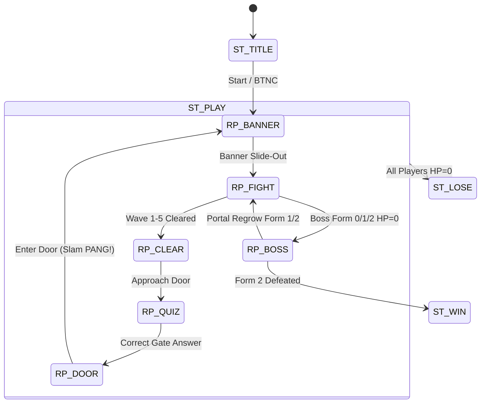

# แผนการทำสไลด์ Canva — DRAGO-NEXUS V5 ARENA EDITION (CPE222 Final Project)

> **อ้างอิงเกณฑ์:** `UTF-8CPE222+Final+brief.pdf` (CPE222 Digital Logic Design — Digilent Nexys A7-100T)
> **เวลาพูดทั้งหมด:** **7 นาที 00 วินาที** | **สมาชิก:** **5 คน** | **จำนวนสไลด์:** **11 สไลด์** (กระชับ เฉลี่ยสไลด์ละ ~35–45 วินาที)

---

## 0. แนวทางตกแต่งใน Canva (Theme & Visuals)
- **Theme แนะนำ:** *Retro Arcade / Cyberpunk Dark* (`#0D1117` พื้นหลังเข้ม, `#00E5FF` Cyan เน้นหัวข้อเทคนิค, `#FFD54F` Gold เน้นคีย์เวิร์ด/คะแนน, `#FF4081` Neon Pink เน้นบอส/เอฟเฟกต์)
- **ฟอนต์:** หัวข้อ `Space Grotesk` หรือ `Montserrat ExtraBold` / เนื้อหา `Noto Sans Thai` + `IBM Plex Sans Thai`
- **รูปภาพจริงจาก RTL ที่นำไปใส่ใน Canva ได้ทันที:**
  - `D:\vivado_pj\DRAGO_NEXUS_V2\sprite_preview.png` (รวมฮีโร่หน้าคน 4 ตัว + ศัตรูหน้าคน 8 ตัว + บอส `Ajarn_V` 3 ร่าง + ไอเทมหัวใจ)
  - `D:\vivado_pj\DRAGO_NEXUS_V2\docs\screenshots\shot_title.png` (หน้าจอ Title)
  - `D:\vivado_pj\DRAGO_NEXUS_V2\docs\screenshots\shot_combat_lunge.png` (ฉากต่อสู้ในห้องเดี่ยว + 360° Nova)
  - `D:\vivado_pj\DRAGO_NEXUS_V2\docs\screenshots\shot_coop_zoom.png` (หน้าต่าง Logic Gate Quiz)
  - `D:\vivado_pj\DRAGO_NEXUS_V2\docs\screenshots\shot_boss_locked.png` (บอส Ajarn_V + Portal + คำพูดเบียว)

---

## 1. การแบ่งเวลาพูด 7 นาที สำหรับสมาชิก 5 คน

| สมาชิก | บทบาท / ช่วงที่รับผิดชอบ | สไลด์ | เวลาพูด |
| :--- | :--- | :--- | :--- |
| **คนที่ 1** | เปิดตัวทีม, Game Concept & Objectives, Hardware Requirements | Slide 1 – 3 | **1 นาที 15 วินาที** (`0:00 – 1:15`) |
| **คนที่ 2** | Feature 1 (Movable Player, Arena, Smooth Zoom, Combat) & Feature 2 (Sprite Evolution & SW0–SW3 Skins) | Slide 4 – 5 | **1 นาที 20 วินาที** (`1:15 – 2:35`) |
| **คนที่ 3** | Feature 3 (Own Features: 2P Co-op, Logic Gate Quiz Door, 3-Form Boss Portal, BGM) & System Block Diagram | Slide 6 – 7 | **1 นาที 25 วินาที** (`2:35 – 4:00`) |
| **คนที่ 4** | เจาะลึก **Finite State Machine (FSM)** และ **PC-to-FPGA Joystick Bridge** | Slide 8 – 9 | **1 นาที 40 วินาที** (`4:00 – 5:40`) |
| **คนที่ 5** | Work Plan / การแบ่งงาน 5 คน, ความคืบหน้า & Demo สด/วิดีโอ, สรุปจบ | Slide 10 – 11 | **1 นาที 20 วินาที** (`5:40 – 7:00`) |

---

## 2. โครงสร้างสไลด์ทั้ง 11 หน้า (Layout + เนื้อหาที่จะใส่ใน Canva)

### Slide 1 — Title Slide (0:00 – 0:20 | คนที่ 1)
- **หัวข้อใหญ่:** `DRAGO-NEXUS V5 : ARENA EDITION`
- **หัวข้อรอง:** `2D Co-op Action RPG on Digilent Nexys A7-100T FPGA`
- **ข้อมูลประกอบ:**
  - รายวิชา CPE222 Digital Logic Design | กลุ่มที่ `<Group Number>`
  - รายชื่อสมาชิก 5 คน + รหัสนักศึกษา
- **ภาพประกอบ Canva:** ภาพบอร์ด Nexys A7 + ภาพหน้าจอ `shot_title.png`

---

### Slide 2 — Game Concept & Project Objectives (0:20 – 0:50 | คนที่ 1)
- **ตรงตาม Brief หน้า 2 (Objectives):**
  1. ออกแบบวงจรดิจิทัล Real-time บน FPGA ด้วย **Pure Verilog HDL** (ไม่ใช้ MicroBlaze)
  2. สร้าง **VGA Controller (`640×480 @ 60 Hz`, 12-bit RGB444)**, Sprite Compositor และจัดการ Input หลายรูปแบบ
  3. ควบคุม Game Logic ทั้งหมดด้วย **Finite State Machines (FSM)**
- **Concept เกม:**
  - ตะลุย **Single-Room Arena (6 Waves)** สู้กับศัตรูหน้าคนล้วน ฝ่าประตูสไลด์ที่ต้อง **ตอบควิซ Logic Gate** ให้ถูกก่อนผ่านด่าน และปิดท้ายด้วยบอส **Ajarn_V 3 ร่างงอกจาก Portal**

---

### Slide 3 — Hardware & Technical Requirements Compliance (0:50 – 1:15 | คนที่ 1)
- **ตรงตาม Brief หน้า 3 (Hardware & Requirements):**
  - **Display:** VGA 12-bit RGB (`4096` สี) ความละเอียด `640×480 @ 60 Hz` (`clk25` จาก `clk_gen`)
  - **I/O on Board:** ปุ่มกด 5 ปุ่ม (`BTNC/U/D/L/R` ผ่าน **5 ms Debouncer**), สวิตช์ `SW[3:0]` เลือกสกิน, **16 LEDs + 8-Digit 7-Segment** แสดงคะแนน/HP/Wave
  - **VBlank Update:** อัปเดตตรรกะเกมเฉพาะช่วง Vertical Blanking (`vga_x == 0, vga_y == 480`, 60 Hz) ป้องกันภาพฉีกขาด (Screen Tearing)
  - **Extras:** ADXL362 Accelerometer (`acl_tilt.v`), PWM Audio (`audio_synth_v2.v`), USB-UART (`uart_joy_rx.v`)
  - **Third-Party Credit:** ให้เครดิตการดัดแปลง SPI driver `acl_tilt.v` จาก `FPGADude`

---

### Slide 4 — Feature 1 : Movable Player & Arena Combat (25%) (1:15 – 1:55 | คนที่ 2)
- **ตรงตาม Brief หน้า 4 (Feature 1 — 25%):**
  - **Real-time 8-Direction Control:** บังคับได้ทั้ง **เอียงบอร์ด (Tilt)** และ **จอยสติ๊ก 1P / 2P**
  - **Single-Room Boundary & Collision:** ห้องสี่เหลี่ยมเดี่ยว รอบข้างเป็นสีดำสนิท ชนกำแพง/ศัตรู/ประตูสไลด์แบบ Pixel/Tile-accurate
  - **Extra Complexity:**
    - **Limited Lunge-Snap (`≤72 px`) + 3-Hit Combo + 360° Nova Finisher**
    - **Smooth Camera Auto-Zoom (`0..80` ระดับ, 60 Hz)** ซูมอัตโนมัติสไตล์ Brawlhalla เมื่อผู้เล่น 2 คนเดินห่างกัน
    - **Shadow Dash (อมตะชั่วคราว)** + **Chrono-Shift (ชะลอเวลา)**
- **ภาพประกอบ Canva:** `shot_combat_lunge.png`

---

### Slide 5 — Feature 2 : Sprite Evolutions & Switch Skins (15%) (1:55 – 2:35 | คนที่ 2)
- **ตรงตาม Brief หน้า 5 (Feature 2 — 15%):**
  - **เงื่อนไขชัดเจน (Event-Driven, ≥3 Forms):** เก็บ **Blue Evo Gem** (ระบบแม่เหล็กดูด) เพื่ออัปเกรด 4 ขั้น (**ไร้ Cutscene คั่นจังหวะ เล่นต่อเนื่องทันที!**)
    - `UP0` (เริ่มต้น) → `UP1 (GEM ≥ 10)`: **ปลดล็อก Companion Pet** ยิงบอลช่วยสู้
    - `UP2 (GEM ≥ 25)`: **ปลดล็อก Orbiting Twin Swords** ดาบคู่หมุนรอบตัว
    - `UP3 (GEM ≥ 45)`: **Apex Aura** + ฟื้นเลือดเต็ม `6♥♥♥♥♥♥`
  - **สกินฮีโร่หน้าคนล้วน (`SW[3:0]` Priority Selector):**
    - ตรวจสอบจาก `SW0 → SW3` ยึดสวิตช์หมายเลขสูงสุดที่เปิดอยู่เพียงตัวเดียว (ไม่ผสม): `SW0=PF`, `SW1=PPuen`, `SW2=PPeem`, `SW3=PPing`
  - **ตัดเห็ด/กล่องเสบียงออกทั้งหมด** เหลือเฉพาะ **หัวใจ (`♥`)** และแก้บัค 3-bit HP overflow แล้ว
- **ภาพประกอบ Canva:** `sprite_preview.png` (ชี้ให้เห็น 4 ฮีโร่หน้าคน + 8 ศัตรูหน้าคน + 3 ร่างบอส)

---

### Slide 6 — Feature 3 : Own Creative Features (10%) (2:35 – 3:20 | คนที่ 3)
- **ตรงตาม Brief หน้า 6 (Feature 3 — 10%):**
  1. **2P Co-op Dual-Joystick + แยกหลอดหัวใจ & ระบบชุบเพื่อน (3 วิธี)**
  2. **Sliding Door + Logic Gate Quiz:** เคลียร์ด่านจะมีลูกศรเด้งกระพริบชี้ไปประตูสไลด์ → สุ่มถามสัญลักษณ์ **Logic Gate (`AND/OR/NOT/NAND/NOR/XOR`)** → ตอบถูกประตูจึงเปิด → เดินเข้าห้องใหม่เกิดเอฟเฟค **ล็อคประตูปั้ง! (`DOOR LOCKED! PANG!`)** + แบนเนอร์ `WAVE X` สไลด์ออก
  3. **Final Boss 3-Form Portal Regrowth:** บอส `Ajarn_V` (Wave 6) ตายแล้วมีเอฟเฟคระเบิด + คำพูดสุดเบียว + งอกร่างใหม่จาก **Portal** ครบ 3 ร่าง (`Ajarn_V_1` → `Ajarn_V_2` → `Ajarn_V Thanos`) จึงจะ `VICTORY!`
  4. **3-Channel BRAM Chiptune BGM + SFX**
- **ภาพประกอบ Canva:** `shot_coop_zoom.png` (Logic Gate Quiz) + `shot_boss_locked.png` (Portal + คำพูดเบียว)

---

### Slide 7 — System Architecture & Block Diagram (3:20 – 4:00 | คนที่ 3)
- **โครงสร้างโมดูลหลักใน `drago_nexus_v2_top.v`:**
  - **Clock & Sync:** `clk_gen` (`100→25 MHz`) + `vga_sync` (`640×480 @ 60 Hz`)
  - **Input Subsystems:** `board_io_v2` (5 ms Debounce + 7-Seg/LED), `acl_tilt` (SPI ADXL362), `uart_joy_rx` (`115200 baud`)
  - **Core Logic:** `game_engine_v2` (Time-multiplexed 16-enemy & lock-on FSM, 60 Hz tick)
  - **Graphics & Audio:** `vga_renderer_v2` (5-stage zero-bottleneck pipeline + Dual-port/1P BRAM ROMs) + `audio_synth_v2` (PWM 3-Ch BGM)
- **กราฟิก Canva:** วาด Block Diagram เชื่อมกล่อง Input → `game_engine_v2` → `vga_renderer_v2` / `audio_synth_v2` → VGA/PWM/LED

---

### Slide 8 — Finite State Machine (FSM) Design (4:00 – 4:50 | คนที่ 4)
> *หน้านี้ตามที่ผู้ใช้ต้องการเน้นเป็นพิเศษ — แนะนำวาง Diagram 2 ฝั่งซ้าย/ขวาใน Canva*

- **1. Top-Level Game FSM (`game_state`):**
  - `ST_TITLE (0)` --[กด Start / BTNC]--> `ST_PLAY (2)`
  - `ST_PLAY (2)` --[ชนะ Boss ร่าง 3]--> `ST_WIN (3)`
  - `ST_PLAY (2)` --[HP หมดทุกตัว]--> `ST_LOSE (4)`
  - `ST_WIN / ST_LOSE` --[Retry / Menu]--> `ST_PLAY` / `ST_TITLE`
- **2. Room & Boss Progression Sub-FSM (`room_phase` ภายใน `ST_PLAY`):**
  - `RP_BANNER (0)`: แสดง `DOOR LOCKED! PANG!` + แบนเนอร์ `WAVE X` กลางจอแล้วสไลด์ออก → Spawn ศัตรู → `RP_FIGHT`
  - `RP_FIGHT (1)`: สู้ศัตรู/บอส (Time-multiplexed `step_state 0..59`)
    - เคลียร์ศัตรู Wave 1–5 → `RP_CLEAR (2)` *(ลูกศรเด้งกระพริบ)*
    - ชนประตูสไลด์ → `RP_QUIZ (3)` *(ควิซสุ่ม Logic Gate)*
    - ตอบถูก → `RP_DOOR (4)` *(ประตูสไลด์เปิด)* → เดินเข้าประตู → `wave+1`, `RP_BANNER (0)`
  - `RP_BOSS (5)`: เมื่อบอสร่าง 0/1/2 ตาย → แสดงเอฟเฟคตาย + คำพูดเบียว + Portal งอกร่างถัดไป → กลับ `RP_FIGHT` (หรือ `ST_WIN` หลังร่าง 3)

---

### Slide 9 — PC-to-FPGA Joystick Bridge (`joy_bridge.py` + `uart_joy_rx.v`) (4:50 – 5:40 | คนที่ 4)
> *หน้านี้ตามที่ผู้ใช้ต้องการอธิบายการทำงานของคอมพิวเตอร์เป็นสะพานเชื่อมจอยเข้าบอร์ด*

- **ทำไมต้องใช้ PC เป็น Bridge?**
  - พอร์ต USB HID ของบอร์ด Nexys A7 รองรับเฉพาะ USB Keyboard/Mouse มาตรฐาน ไม่รองรับ Twin USB Gamepad (HID Descriptor เฉพาะ) โดยตรงบน Pure Verilog
  - เราจึงออกแบบ **Zero-Dependency Python Bridge (`scripts/joy_bridge.py`)** ใช้คอมพิวเตอร์เป็นสะพานอ่านจอยคู่แล้วส่งผ่าน **USB-UART (FTDI)** เข้าขา `UART_TXD_IN` ของ FPGA!
- **Pipeline การทำงาน 4 ขั้นตอน (60 Hz Real-time):**
  1. **Read Dual Gamepad (PC):** เรียก Windows API `winmm.dll` (`joyGetPosEx`) อ่านแกน `dx, dy` และปุ่ม `Fire/Dash/Chrono` ของ **จอย 1 และ จอย 2** (รองรับทั้งโหมด **Analog 2 ความเร็ว** และ **Digital D-Pad**)
  2. **Pack 3-Byte Protocol:** แพ็คข้อมูลจอยคู่เป็น **3 ไบต์** โดยใช้ **MSB Bit 7 = `1` (`0x80`) เป็น Sync Header** กันข้อมูลหลุดเฟรม:
     - `Byte 0`: `[1 | dy1+2 (3b) | dx1+2 (3b)]`
     - `Byte 1`: `[0 | dy2+2 (3b) | dx2+2 (3b)]`
     - `Byte 2`: `[0 | btn2 (3b)  | btn1 (3b)]`
  3. **Stream via Serial (PC → FPGA):** ใช้ Windows `kernel32.dll` ส่งออกพอร์ต `COMx` ที่ **`115,200 baud`** ทุกๆ `1/60` วินาที *(ไม่ต้องลง library เสริม!)*
  4. **Decode on FPGA (`uart_joy_rx.v`):** วงจร UART Receiver บน `clk25` (`217 clocks/bit`) ตรวจบิต Sync `0x80` แล้วถอดรหัสเป็นสัญญาณ `j1_dx/dy/btn` และ `j2_dx/dy/btn` พร้อมสถานะ **`USB JOY: ONLINE!`**

---

### Slide 10 — Work Plan & Team Division (5 Members) (5:40 – 6:20 | คนที่ 5)
- **ตรงตาม Brief หน้า 7 (Schedule: 13/11 Proposal → 20/11 Progress → 27/11 Final Submit):**
  - **คนที่ 1:** Top-level Integration, Clock/VGA Sync (`clk_gen`, `vga_sync`), Debouncer & 7-Seg/LED (`board_io_v2`), Timing/Constraints (`.xdc`)
  - **คนที่ 2:** Game Engine FSM (`game_engine_v2`), Room Bounds, Smooth Camera Zoom, Combat & Logic Gate Quiz Logic
  - **คนที่ 3:** 5-Stage Pipelined VGA Renderer (`vga_renderer_v2`), Sprite/Tile ROMs (`generate_assets_v2.py`), HUD & Overlays
  - **คนที่ 4:** Input & Bridge (`joy_bridge.py`, `uart_joy_rx.v`, `acl_tilt.v`) + 3-Channel BRAM Audio Synth (`audio_synth_v2.v`)
  - **คนที่ 5:** Simulation Testbenches (`tb_game_v2.v`, `tb_vga_capture.v`), On-board Hardware Verification, Proposal/Report & Video Demo

---

### Slide 11 — Current Progress, Verification & Demo Plan (6:20 – 7:00 | คนที่ 5)
- **ผลลัพธ์ปัจจุบัน (ทำเสร็จและทดสอบจริงแล้ว!):**
  - **RTL Simulation (`tb_game_v2.v`):** `RESULT : PASS` (`0 errors`) ครอบคลุม Dual-Joy UART, Lunge/Nova, Heart-only pickup, Quiz Door + Slam, 3-Form Boss Portal → Victory, `SW[3:0]` Skin Priority
  - **FPGA Synthesis & Implementation (Vivado 2024.2):** ผ่าน `write_bitstream` บน Nexys A7-100T จริง (Timing ผ่านทุก path, `0` Latch)
  - **แผนถึงวันส่ง (20/11 – 27/11):** อัดวิดีโอ Demo สดบนจอ VGA + บอร์ดจริง, จัดทำ Final Report PDF (รวม Block Diagram, FSM, ปัญหา/วิธีแก้ และ References)
- **ปิดท้าย:** *"ขอบคุณครับ/ค่ะ — พร้อมตอบคำถามและแสดง Live Demo บนบอร์ดครับ!"*
